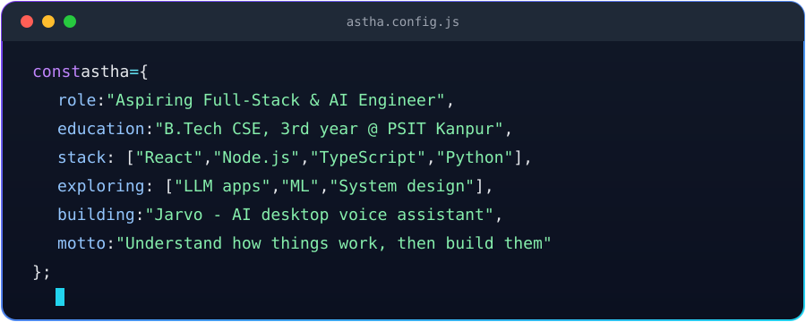
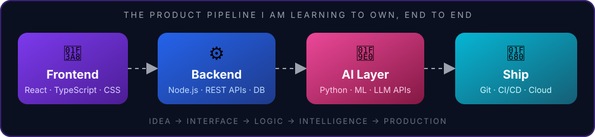
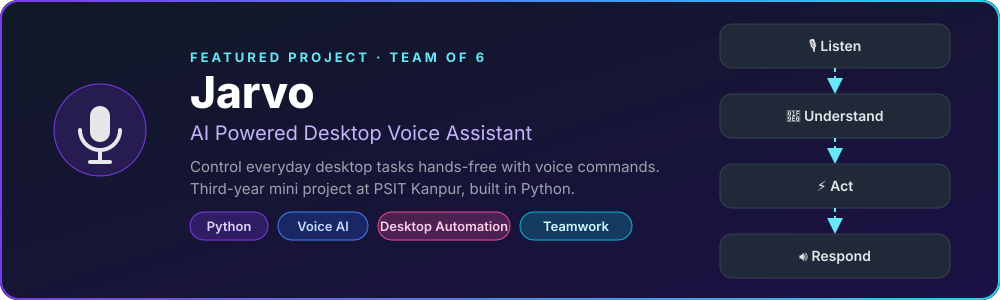
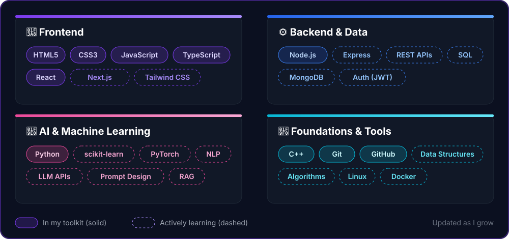
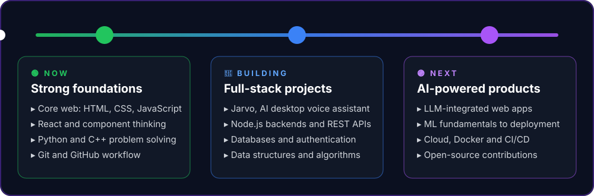
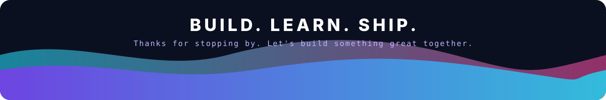

 

## 👋 About Me

I'm a **B.Tech Computer Science and Engineering student (3rd year)** at **Pranveer Singh Institute of Technology, Kanpur**. I'm curious by nature: I like knowing how things actually work, and then building them myself.

My direction is clear: **Full-Stack Development + Artificial Intelligence**. I want to own a product end to end, from the interface a user touches to the intelligence running behind it.

  

## 🎯 What I'm Aiming For

  

 

| 🧭 Focus | 💡 What it means for me |
| :-- | :-- |
| **Full-Stack Web** | Responsive React interfaces backed by clean Node.js APIs and real databases |
| **Applied AI** | Using ML and LLMs inside real products, not just notebooks |
| **Engineering Habits** | Readable code, Git discipline, documentation, and shipping working things |

## 🚀 Featured Project

  <a href="https://github.com/katiyaraastha"><!-- TODO: replace this link with the Jarvo repository URL once it is public -->
    
  </a>

 

> **Jarvo** is a desktop voice assistant that turns spoken commands into actions. I worked on it as part of a six-member team, which taught me how to split work, review each other's code, and integrate it into one product.

## 🛠️ Tech Stack

  

 

## 🧭 Roadmap

  

## 📊 GitHub Activity

## 🤝 Let's Connect

I'm looking for **internships and collaborations** in full-stack development and applied AI. If you're building something interesting, or just want to talk about code, say hello.

 

